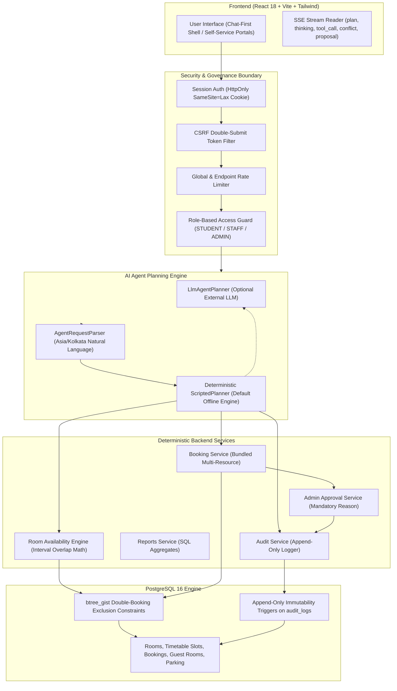

# JKLU CampusFlow

> **AI-Agent-Powered Campus Venue, Guest House, and Parking Management System**  
> Built for the **JKLU AI-Buildathon 1.0 (Problem Statement PS-02)**.

---

## 1. Problem Statement (PS-02) & What It Does

### The Problem
Campus event organizers (faculty, student club leads, administrative officers) spend hours manually cross-checking semester timetables across multiple departments, guessing room availability, and coordinating separate paperwork for guest house rooms and visitor parking passes. Timetable clashes and double-bookings frequently disrupt academic schedules.

### What CampusFlow Does (in 5 Lines)
1. **Chat-First AI Assistant**: Understands natural language campus event requests with relative date/time parsing in `Asia/Kolkata`.
2. **Deterministic Conflict Solving**: Queries real database tables and timetable engines to detect clashes and recommend free fitting alternatives.
3. **Multi-Resource Proposals**: Automatically bundles classrooms/amphitheatres, MDC Guest House suites, and visitor parking into one request.
4. **Human-in-the-Loop Governance**: Proposals require administrative approval (`PENDING` state) with zero auto-approvals and mandatory rejection reasons.
5. **Tamper-Evident Accountability**: Every plan step, tool call, and approval decision is recorded in PostgreSQL append-only audit logs.

---

## 2. Evaluation Criteria & Feature Mapping

See [docs/EVALUATION_MAPPING.md](docs/EVALUATION_MAPPING.md) for complete rubric mapping to files and automated tests:

- **Multi-Step Reasoning & Planning**: Dynamic planning decomposing queries into candidate selection, timetable checking, guest house booking, and parking allocation.
- **Deterministic Tools vs. Agent**: Mathematical interval-overlap availability engine and PostgreSQL `btree_gist` exclusion constraints guarantee zero double-bookings.
- **Adaptability & Conflict Recovery**: Automatically detects timetable clash at Room `C-204` (`CS201 Data Structures`), simulates retry, and recommends free alternatives (`A-201`, `M-201`).
- **Approval Gates & Governance**: Proposal cards create `PENDING` bookings; Admins approve/reject via `/admin/approvals`.
- **Role-Based Access Control**: Strict matrix enforcing Student vs. Staff vs. Admin permissions (students cannot see or book research labs/amphitheatres).
- **Auditability & Explainability**: Immutable append-only audit log enforced by database triggers for `AGENT_REASONING` and `TOOL_CALL`.

---

## 3. System Architecture



---

## 4. Tech Stack

- **Backend**: Spring Boot 3.5.16, Java 26 host runtime targeting Java 21 LTS bytecode (`release=21`), Spring Security, Spring Data JPA, Flyway.
- **Frontend**: React 18, Vite 5, TypeScript (strict mode), Tailwind CSS, Radix UI primitives, Lucide Icons, Recharts.
- **Database**: PostgreSQL 16 with `btree_gist` extension for exclusion constraints.
- **Testing**: JUnit 5, MockMvc, AssertJ, Vitest, React Testing Library, Knip, ESLint 9.

---

## 5. Quick Start from a Fresh Machine (5 Minutes)

### Step 1: Install Prerequisites
- **Java**: JDK 21 or JDK 26 installed (`java -version`).
- **Node.js**: Node 18+ and npm installed (`node -v`, `npm -v`).
- **PostgreSQL**: PostgreSQL 16 running on `localhost:5432`.

### Step 2: Database & User Setup
Open `psql` or pgAdmin as the `postgres` administrative user and execute:
```sql
-- 1. Create the dedicated database user
CREATE USER campusflow WITH PASSWORD '<choose a password>';

-- 2. Create the development and test databases
CREATE DATABASE campusflow OWNER campusflow;
CREATE DATABASE campusflow_test OWNER campusflow;

-- 3. Enable btree_gist extension on both databases (required for exclusion constraints)
\c campusflow;
CREATE EXTENSION IF NOT EXISTS btree_gist;

\c campusflow_test;
CREATE EXTENSION IF NOT EXISTS btree_gist;
```

### Step 3: Configure Environment Variables
Copy both `.env.example` templates:

1. **Backend Configuration**:
   ```powershell
   cd backend
   Copy-Item .env.example .env
   ```
   Open `backend/.env` and update:
   - `DB_USER=campusflow`
   - `DB_PASSWORD=<choose a password>` (must match the password chosen in Step 2)
   - `DEMO_USER_PASSWORD=Demo@2024` (or any password — must match `VITE_DEMO_PASSWORD` in frontend)

2. **Frontend Configuration**:
   ```powershell
   cd ../frontend
   Copy-Item .env.example .env
   ```
   Open `frontend/.env` and ensure:
   - `VITE_API_BASE_URL=http://localhost:8080`
   - `VITE_USE_MOCKS=false`
   - `VITE_DEMO_MODE=true`
   - **`VITE_DEMO_PASSWORD` must exactly match `DEMO_USER_PASSWORD` from `backend/.env`**

### Step 4: Run the Backend
From the `backend/` directory:
- **Windows (PowerShell)**:
  ```powershell
  $env:SPRING_PROFILES_ACTIVE="dev,demo"
  .\mvnw.cmd spring-boot:run
  ```
- **Linux / macOS (Bash)**:
  ```bash
  export SPRING_PROFILES_ACTIVE="dev,demo"
  ./mvnw spring-boot:run
  ```
*Wait until the log displays: `Tomcat started on port 8080 (http)` and `Demo users synced (demo profile)`.*

### Step 5: Run the Frontend
In a new terminal window:
```powershell
cd frontend
npm install
npm run dev
```
Open **[http://localhost:5173](http://localhost:5173)** in your browser.

### Demo Account Credentials
When `VITE_DEMO_MODE=true`, the login screen displays quick 1-click login pills for each role.

> [!NOTE]
> All three demo accounts share the same password. The login page shows clickable **Quick Login** pills — click one to fill the credentials automatically.

| Role | Email | Password |
| :--- | :--- | :--- |
| **Student** | `student@demo.jklu.test` | `Demo@2024` |
| **Staff** | `staff@demo.jklu.test` | `Demo@2024` |
| **Admin** | `admin@demo.jklu.test` | `Demo@2024` |

**What each role can do:**
- **Student**: Book classrooms and general zones; view own bookings; chat with AI agent.
- **Staff**: Everything a student can do, plus amphitheatres, research labs, MDC Guest House suites, and visitor parking.
- **Admin**: Everything staff can, plus the Approvals queue, Timetable CSV import, Master Data management, Audit Log, and Reports dashboard.

---

## 6. 3-Minute Demo Walkthrough

Follow the scripted guide in [backend/docs/DEMO_SCRIPT.md](backend/docs/DEMO_SCRIPT.md):
1. **Login as Staff**: Click `staff@demo.jklu.test` on `/login`.
2. **Ask the Agent**: Type:
   > *"Guest lecture next Thursday 3-5 PM, 80 people, speaker from Delhi needing stay and parking"*
3. **Observe SSE Streaming**:
   - The agent constructs a dynamic 6-step plan.
   - Evaluates candidate room `C-204`, simulates tool retry, and detects clash with `CS201 Data Structures`.
   - Emits the **Conflict Card** and suggests free alternatives (`A-201`, `M-201`).
   - Automatically allocates MDC guest room `G-102` and visitor parking `P-VISITOR`.
   - Renders the structured **Proposal Card**.
4. **Submit for Approval**: Click **"Submit for Approval"** (creates a `PENDING` booking).
5. **Admin Approval**: Log in as `admin@demo.jklu.test` on `/admin/approvals` and click **Approve**.
6. **Verify Calendar & Audit Trail**:
   - Check Room Availability at `/finder` — Room `A-201` is reserved for Thursday 15:00–17:00.
   - Check `/admin/audit` to see immutable `AGENT_REASONING`, `TOOL_CALL`, and `APPROVAL` records.

---

## 7. Troubleshooting

| Symptom | Cause | Solution |
| :--- | :--- | :--- |
| **Port 8080 already in use** | Stray Java process running in background | Run `Get-Process -Name java \| Stop-Process -Force` (Windows) or `pkill -f campusflow` (Linux). |
| **Port 5173 already in use** | Stray Node.js process | Run `Get-Process -Name node \| Stop-Process -Force` or use `npm run dev -- --port 5174`. |
| **`type "gist" does not exist`** | `btree_gist` extension missing | Connect as superuser and run `CREATE EXTENSION IF NOT EXISTS btree_gist;` on `campusflow` and `campusflow_test`. |
| **Wrong password on 1-click login** | Password mismatch between `.env` files | Ensure `VITE_DEMO_PASSWORD` in `frontend/.env` matches `DEMO_USER_PASSWORD` in `backend/.env`. |
| **`Access is denied` in PowerShell** | Restricted execution policy | Run PowerShell as Administrator and execute `Set-ExecutionPolicy -Scope CurrentUser RemoteSigned`. |
| **Rate Limit 429 Too Many Requests** | Exceeded 5 logins/min or 10 msgs/min | Wait 60 seconds for the rate limiting window to clear (`Retry-After: 60`). |

---

## 8. Known Limitations & Future Work

1. **PDF Timetable Import**: Timetable ingestion currently supports structured CSV and XLSX formats with row-level validation. Unstructured PDF parsing is intentionally deferred due to PDF layout variability.
2. **LLM Planner Optional (Scripted Default)**: The system defaults to the deterministic data-driven planner to guarantee 100% offline uptime and zero API failures. An external LLM (Gemini / OpenAI) can be enabled via `LLM_API_KEY`.
3. **In-Memory Rate Limiting & Sessions**: Session authentication and token-bucket rate limiting use in-memory state. Scaling horizontally across multiple server instances requires a shared Redis backing store.
4. **Synthetic Demo Dataset**: Demo data includes a deliberately seeded timetable clash at `C-204` on Thursday 15:00–16:00 to demonstrate conflict resolution.
5. **Database Migration Role Separation**: In development, Flyway runs with application database privileges. Production deployments should use a dedicated migration user with DDL privileges separate from the runtime app user.
6. **Containerization**: Docker containerization is slated as future work; current instructions use native local PostgreSQL.
7. **Java 21 Bytecode on JDK 26 Runtime**: The application is compiled with `<maven.compiler.release>21</maven.compiler.release>` to ensure 100% compatibility with Spring Framework 6.2's ASM scanner and ByteBuddy agent loading while running smoothly on modern JDK 26 runtimes.

---

## 9. Visual Screenshots

See [docs/screenshots/README.md](docs/screenshots/README.md) for the screenshot capture checklist:
- `01_chat_streaming_flow.png` - Agent streaming execution plan and tool calls.
- `02_conflict_and_alternatives.png` - Timetable clash card and alternative recommendations.
- `03_proposal_card_bundle.png` - Multi-resource booking proposal card.
- `04_approval_queue.png` - Administrator approvals queue.
- `05_timetable_conflict_heatmap.png` - Venue availability heatmap (08:00–20:00).
- `06_audit_log_traceability.png` - Append-only audit log with tool execution details.
- `07_utilisation_reports.png` - Campus venue utilisation and occupancy charts.
- `08_timetable_csv_sync.png` - Timetable upload validation preview.

---

## 10. Team (JKLU Buildathon PS-02)

- **Team Name**: CampusFlow Team
- **Members**:
  - Member 1 (Lead Developer / Full-Stack & AI Agent)
  - Member 2 (Backend Systems & Database Architecture)
  - Member 3 (Frontend UX & Design Systems)
- **Institution**: JK Lakshmipat University (JKLU), Jaipur
